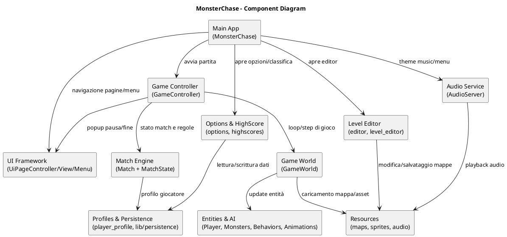
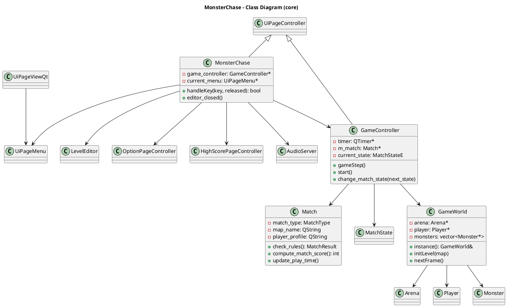

# Architettura di MonsterChase

## Descrizione dell'architettura ad alto livello

MonsterChase è organizzato in livelli logici che separano il **flusso applicativo**, la **simulazione di gioco**, la **presentazione UI** e i **servizi trasversali**.

A livello alto:

1. **Application/UI Flow**: `MonsterChase` e i controller/pagine UI gestiscono menu, navigazione e transizioni tra schermate (main menu, opzioni, editor, classifica, partita).
2. **Game Orchestration**: `GameController` governa il ciclo della partita, i timer, la macchina a stati (`MatchState`) e coordina l'aggiornamento del mondo.
3. **Game Domain**: `Match` incapsula regole/modalità (strategy), mentre `GameWorld` mantiene le entità runtime (arena, player, monsters) e avanza la simulazione frame-by-frame.
4. **Entities & AI**: Player e Monster usano componenti di comportamento/animazione (in `src/lib`, `src/player`, `src/monsters`) per movimento, collisioni e decisioni.
5. **Infrastructure**: persistenza/profili, audio, risorse e level editor supportano il dominio senza accoppiarsi alla logica core.

L'architettura combina pattern pratici:

- **Controller/View separation** nel mini framework UI (`UiPageController`, `UiPageViewQt`, `UiPageMenu`).
- **State pattern** per gli stati di match (`match_sm`).
- **Strategy-like behavior** per varianti di `Match` create via factory.
- **Singleton/Facade** in `GameWorld` per accedere allo stato globale della simulazione.

---

## Component diagram (PlantUML)

---

## Class diagram (PlantUML)

---

## Descrizione sintetica dei componenti

- **Main App (`MonsterChase`)**  
  Entry point logico dell'esperienza utente: costruisce i menu, intercetta input globali, apre pannelli secondari (editor/opzioni/classifica) e delega la partita a `GameController`.

- **UI Framework (`src/lib/ui_framework`)**  
  Astrazione di pagine, widget e menu basata su Qt Graphics View. Riduce il coupling tra logica di navigazione e rendering dei componenti.

- **Game Controller (`GameController`)**  
  Coordina il game loop tramite timer, innesca `GameWorld::nextFrame()`, gestisce pause/fine partita e transizioni degli stati match.

- **Match Engine (`Match` + `match_sm`)**  
  Modella modalità e regole di vittoria/sconfitta, punteggio e progressione temporale. La factory di match abilita varianti senza cambiare il controller.

- **Game World (`GameWorld`)**  
  Contiene lo stato runtime del livello (arena, player, mostri), inizializza/deinizializza le mappe e applica l'avanzamento della simulazione.

- **Entities & AI (`player`, `monsters`, `lib/behaviors`, `lib/animations`)**  
  Implementa movimento, collisioni, comportamento e animazioni delle entità di gioco. È il nucleo della dinamica hunter/hunted.

- **Level Editor (`editor`, `level_editor`)**  
  Tool interno per creare/modificare mappe e contenuti del livello, riusando parte dell'ecosistema Qt del progetto.

- **Options & HighScore (`options`, `highscores`)**  
  Gestione impostazioni utente e visualizzazione/aggiornamento classifiche.

- **Profiles & Persistence (`player_profile`, `lib/persistence`)**  
  Persistenza di profili, score e dati di supporto tra sessioni.

- **Audio Service (`AudioServer`)**  
  Servizio dedicato alla riproduzione audio/music score e integrazione sonora delle schermate.

- **Resources (`resources`, `models`)**  
  Asset statici (mappe, sprite, audio, immagini) caricati da gameplay, UI ed editor.
